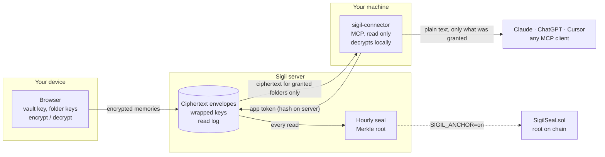
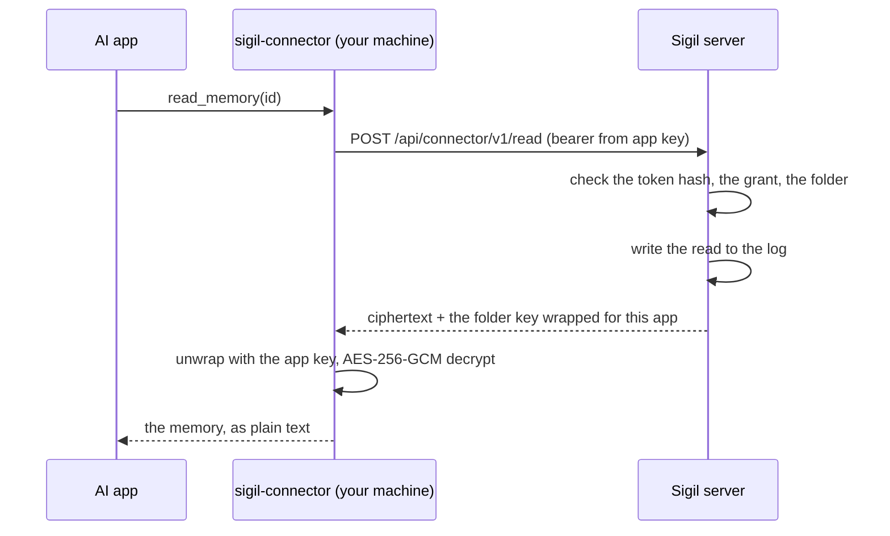

<div align="center">


<br/>

[](LICENSE)
[](#the-encryption-model)
[](#the-connector)
[](#tests)
[](#repository)

**One memory for every AI you use. Encrypted on your device. Read only where you allow it. Every read on the record.**

[How it works](#how-it-works) · [Encryption](#the-encryption-model) · [Connector](#the-connector) · [Seals](#hourly-seals) · [Threat model](#threat-model) · [Run it](#run-it) · [Roadmap](#roadmap)

</div>

---

## Why Sigil

Every AI app keeps its own memory of you, locked inside that app, readable by the company that runs it. Sigil turns that around.

- **One vault, every app.** Claude, ChatGPT, Cursor and any MCP client read the same memory through one connector.
- **Encrypted before it leaves your device.** The server stores envelopes it cannot open. Search runs on your machine.
- **Per app, per folder.** Claude may read *Work* and *Writing*, Cursor only *Work*, and nothing reads *Health* unless you say so. Revoke takes effect on the very next request.
- **Every read on the record.** Each read by each app is logged, and every finished hour of the log is sealed into one fingerprint you can verify in your browser.
- **Bring your history.** Import a ChatGPT or Claude data export in one step. It is parsed and encrypted in the browser.
- **Real delete.** Delete a memory, a folder or the whole account, and it is gone. Export everything, decrypted on your device, at any time.

---

## How it works



1. **Create a vault** with a passkey or a wallet. The browser makes a random 256-bit vault key and a 24-word recovery phrase.
2. **Write or import** memories. Each is encrypted with its folder's key before it is sent.
3. **Connect an app.** The vault makes an app key for it, shown once, that can unwrap only the folders you picked.
4. **The app reads** through `sigil-connector` on your machine, which fetches ciphertext and decrypts it locally.
5. **Every read is logged**, and at the end of each hour the log is sealed into a Merkle root.

<details>
<summary><b>A single read, step by step</b></summary>



</details>

---

## The encryption model

| Key | Made where | Wrapped by | Used for |
| --- | --- | --- | --- |
| **Vault key** (256-bit) | Your browser, at sign-up | Each sign-in method separately: passkey PRF output, a wallet signature over a fixed message, the 24-word recovery phrase | Wrapping the folder keys |
| **Folder key** | Your browser | The vault key | Encrypting every memory in that folder |
| **App key** `sigil_app.<id>.<secret>` | Your browser, shown once | Never stored | Deriving the app's bearer token and the key that unwraps only its granted folder keys |

Every ciphertext is AES-256-GCM, bound to its own record with associated data, so an envelope cannot be swapped into another record. Keys are derived with HKDF.

**What the server sees, and what it does not**

| The server stores | The server never sees |
| --- | --- |
| Ciphertext envelopes, ids, sizes, times | Your memories, titles, tags or folder names in readable form |
| Hashes of sign-in and app tokens | Your vault key, folder keys, app keys or recovery phrase |
| Wallet addresses used to sign in | What an AI app searched for (search runs in the connector) |
| Which app read which memory id, and when (the read log) | Anything an app was not granted |

---

## The connector

`sigil-connector` is a small MCP server you run on your own machine. It offers three read-only tools:

| Tool | What it does | What lands in your read log |
| --- | --- | --- |
| `list_folders` | The folders this app may read, with how many memories each holds | The app listed its folders |
| `search_memories` | Searches titles, tags and first lines of memories, decrypted and searched locally | The app read the index of its folders |
| `read_memory` | Returns one memory in full | The app read that memory |

There is no write, change or delete tool: an AI app cannot plant false memories in your vault.

<details>
<summary><b>Claude Desktop</b></summary>

`~/Library/Application Support/Claude/claude_desktop_config.json` on macOS, `%APPDATA%\Claude\claude_desktop_config.json` on Windows:

```json
{
  "mcpServers": {
    "sigil": {
      "command": "node",
      "args": ["/path/to/Sigil/connector/dist/index.js"],
      "env": {
        "SIGIL_APP_KEY": "sigil_app.<app id>.<secret>",
        "SIGIL_URL": "http://localhost:3000"
      }
    }
  }
}
```

</details>

<details>
<summary><b>Cursor and other stdio MCP clients</b></summary>

The same command and environment, in the client's MCP settings:

```sh
SIGIL_APP_KEY=sigil_app.<app id>.<secret> \
SIGIL_URL=http://localhost:3000 \
node /path/to/Sigil/connector/dist/index.js
```

</details>

<details>
<summary><b>ChatGPT and clients that need a URL</b></summary>

```sh
node /path/to/Sigil/connector/dist/index.js --http --port 8787
# serves http://127.0.0.1:8787/mcp/<token>
```

ChatGPT reaches it through a tunnel you run yourself; what it may connect depends on your ChatGPT plan.

</details>

---

## Hourly seals

Every request a connected app makes is written to your read log with a random salt. When an hour ends, all of that hour's entries become leaves of one Merkle tree, and its root is the seal for that hour.

- **Verify any entry in your browser.** The vault's read log has a Verify button on each entry: it rebuilds the path from the entry to the hour's root.
- **On chain, when switched on.** `contracts/src/SigilSeal.sol` records hourly roots so nobody, Sigil included, could change them later. It is written and tested (15 Foundry tests, including fuzzing and a shared test vector that proves the browser and the contract compute seals the same way) and is not deployed yet. While `SIGIL_ANCHOR` is off, every seal is labelled *Local*.

---

## Threat model

| If this happens | What it means for you |
| --- | --- |
| The Sigil server is breached | The attacker gets ciphertext, wrapped keys and token hashes. Without your keys none of it opens. |
| An app is given *Work* only | It never receives the keys for other folders, so it could not read them even if it tried. |
| You revoke an app | Its token hash and wrapped keys are deleted; its next request fails. What it already read, it keeps. |
| You lose your passkey | Sign in with a wallet or your recovery phrase. Keep at least two ways in. |
| You lose every way in | The vault cannot be recovered, by you or by Sigil. That is the price of keys only you hold. |
| An AI app misuses text it was allowed to read | Sigil cannot control that. Share folders only with apps you trust. |

---

## Repository

```
Sigil
├── packages/core   client-side cryptography, key slots, app keys, Merkle seals,
│                   search, ChatGPT and Claude export parsers
├── web             the site and the server: Next.js App Router, the vault
│                   dashboard, the API in web/src/server, SQLite storage
├── connector       sigil-connector, the MCP server you run on your machine
├── contracts       SigilSeal.sol for on-chain seal roots (Foundry)
├── e2e             Playwright: the whole product, end to end, in Chrome
└── docs            design brief, screenshots, README assets
```

<details>
<summary><b>API</b></summary>

| Route | What it does |
| --- | --- |
| `GET /api/status` | Health of the service and the seal job |
| `GET /api/seals` | The hourly seals |
| `GET /api/connector/v1/folders` | The folders an app may read (app token) |
| `GET /api/connector/v1/index` | Encrypted titles, tags and first lines of its folders (app token) |
| `POST /api/connector/v1/read` | One memory's ciphertext, logged before it is answered (app token) |

The vault's own routes (sign-up, sign-in, memories, folders, apps, export, delete) are under `web/src/server/api.ts`.

</details>

---

## Run it

Needs Node.js 22.13 or newer (for the built-in SQLite) and, for the contract tests, [Foundry](https://getfoundry.sh).

```sh
npm install
npm run build        # the connector and the site
npm start            # http://localhost:3000, data in web/.data/sigil.db
```

For development: `npm run dev`. Settings are in `web/.env.example`:

| Setting | Default | What it does |
| --- | --- | --- |
| `SIGIL_SEALS` | `on` | Seal the read log at the end of every hour |
| `SIGIL_ANCHOR` | `off` | Publish seal roots to SigilSeal (needs `SIGIL_ANCHOR_RPC_URL`, `SIGIL_SEAL_CONTRACT`, `SIGIL_SEALER_KEY`) |
| `NEXT_PUBLIC_SITE_URL` | | The public address, used in connector snippets |
| `SIGIL_ORIGIN` | | The origin trusted for passkeys in production |

## Tests

```sh
npm run test:unit       # 88: cryptography, imports, search, seals, server, connector
npm run test:contracts  # 15: SigilSeal, with fuzzing and a cross-check against the browser
npm run test:e2e        # 5: sign up, import, connect an app, read, revoke, read fails
```

The server tests check that no plaintext ever reaches the database or leaves the browser.

---

## Roadmap

| | Stage | Status |
| --- | --- | --- |
| 1 | **The vault**: passkey and wallet sign-in, client-side encryption, folders, ChatGPT and Claude import, export, real delete | Built |
| 2 | **Every AI, one memory**: the MCP connector, per-app folder grants, revoke, the read log, hourly seals | Built, browser extension and *sign in with your vault* next |
| 3 | **Your whole digital life**: mail, calendar, code and documents into the vault | Planned |
| 4 | **Memory that thinks**: recall, timelines, memories that keep themselves tidy | Planned |
| 5 | **Your AI self**: a model of you that answers within your rules | Planned |
| 6 | **Agents get memory**: vaults for AI agents and shared spaces | Planned |
| 7 | **The memory economy**: what you know, licensed on your terms | Planned |
| 8 | **Trust**: an open standard for apps that read personal memory | Planned |
| 9 | **Everywhere**: phone app, recovery and legacy | Planned |
| 10 | **Devices**: wearables, car and home | Planned |
| 11 | **Your AI self in the world** | Planned |
| 12 | **Proof of a real life** | Planned |
| 13 | **Collective memory** | Planned |

Plans can change. Nothing in the roadmap is a promise or an offer.

---

<div align="center">

**MIT** · Early software, not yet audited: use it at your own risk and keep your own export.

</div>
