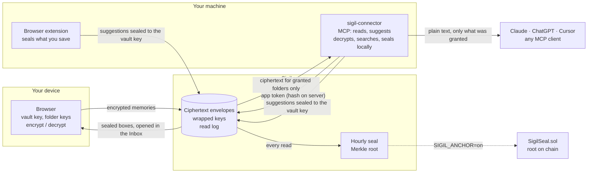
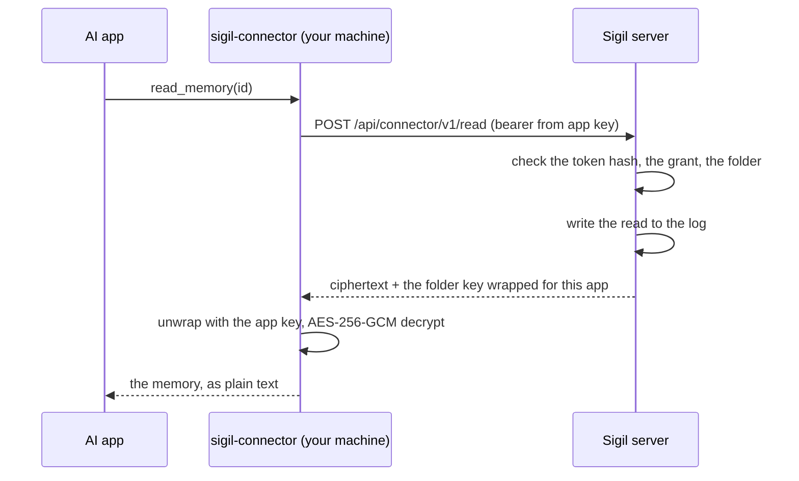
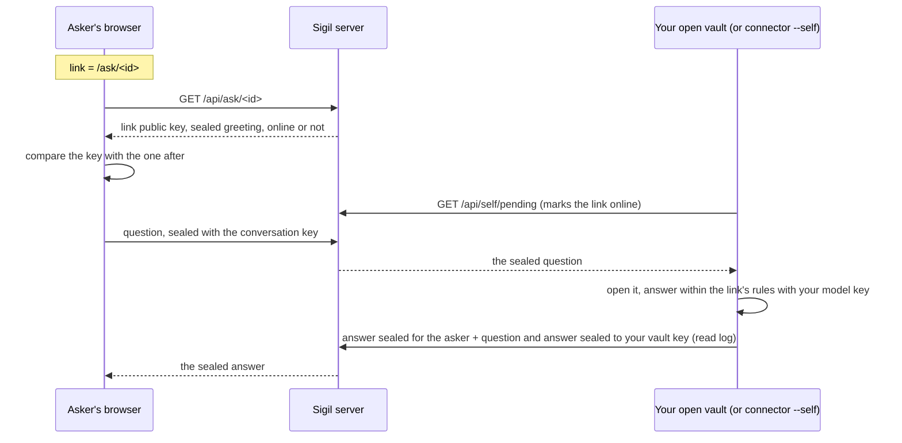

<div align="center">


<br/>

[](LICENSE)
[](#the-encryption-model)
[](#the-connector)
[](#tests)
[](#repository)

**One memory for every AI you use. Encrypted on your device. Read only where you allow it. Every read on the record.**

[How it works](#how-it-works) · [Encryption](#the-encryption-model) · [Connector](#the-connector) · [AI self](#your-ai-self) · [Ask links](#ask-links) · [Inbox](#the-memory-inbox) · [Meaning](#search-by-meaning) · [Thinking](#memory-that-thinks) · [Imports](#your-whole-digital-life) · [Extension](#the-browser-extension) · [Sign in with Sigil](#sign-in-with-sigil) · [Sharing](#sharing-a-folder) · [Legacy](#legacy) · [Devices](#your-phone-and-every-device) · [Agents](#agents-get-their-own-memory) · [Proof](#proof-of-a-real-life) · [Threat model](#threat-model) · [Run it](#run-it) · [Roadmap](#roadmap)

</div>

---

## Why Sigil

Every AI app keeps its own memory of you, locked inside that app, readable by the company that runs it. Sigil turns that around.

- **One vault, every app.** Claude, ChatGPT, Cursor and any MCP client read the same memory through one connector.
- **Encrypted before it leaves your device.** The server stores envelopes it cannot open. Search runs on your machine.
- **Per app, per folder.** Claude may read *Work* and *Writing*, Cursor only *Work*, and nothing reads *Health* unless you say so. Revoke takes effect on the very next request.
- **Every read on the record.** Each read by each app is logged, and every finished hour of the log is sealed into one fingerprint you can verify in your browser.
- **Apps suggest, you decide.** An app you allow can suggest a memory. It is sealed for your vault on the app's side and waits in your inbox until you approve, merge or reject it.
- **Search by meaning, on your device.** A small model runs in your browser and in the connector. Ask about your car and find the note about the garage; the server never sees the query or the vectors.
- **A Self card.** A short profile your apps read first, in its own folder, granted like any other.
- **Save from the browser.** The extension saves a selection, a page or a ChatGPT or Claude conversation to your inbox.
- **Sign in with Sigil.** Web apps ask for the folders they need; you choose, and you can revoke.
- **Share with people.** Share a folder with another vault, read only, and take it back with a new key.
- **Your AI self.** An AI that answers as you, from the folders you choose and within rules you write, with your own model key, run in your browser or in the connector. Share it with a link: questions and answers are end to end encrypted, and every one is in your log.
- **Memory that thinks.** A weekly brief, memories that disagree, every duplicate group merged at once, and expiry dates with real deletion.
- **Bring your history.** Import ChatGPT, Claude, Obsidian, Apple Notes, Gmail and Google Calendar, Notion and GitHub. Parsed and encrypted in the browser, with no app approvals.
- **Legacy.** Name the people who receive your vault, the folders each gets and whether they may talk to your AI self. A legacy key is split in your browser and each share sealed to one person; they open it together, only after you have been away for the period you chose.
- **Your phone and every device.** Install it like an app, add a device by QR code with the vault key sealed to that device only, revoke it, and capture text, links and photos into your inbox (from the share sheet on Android, from the capture screen anywhere).
- **Agents get their own memory.** Agent vaults for Cursor, Claude Code and any MCP client: their own folder, read and write rules, remember, recall, forget and handoff notes, and team spaces shared by vaults and agents.
- **Proof of a real life.** A certificate that your vault has months of continuous sealed history, checked in any browser against the seals, without a word of what is in it.
- **Real delete.** Delete a memory, a folder or the whole account, and it is gone. Export everything, decrypted on your device, at any time.

---

## How it works



1. **Create a vault** with a passkey or a wallet. The browser makes a random 256-bit vault key and a 24-word recovery phrase.
2. **Write or import** memories. Each is encrypted with its folder's key before it is sent.
3. **Connect an app.** The vault makes an app key for it, shown once, that can unwrap only the folders you picked.
4. **The app reads** through `sigil-connector` on your machine, which fetches ciphertext and decrypts it locally.
5. **The app suggests**, if you allow it: the suggestion is sealed to your vault's public key and waits in your inbox.
6. **Every read and suggestion is logged**, and at the end of each hour the log is sealed into a Merkle root.

<details>
<summary><b>A single read, step by step</b></summary>



</details>

---

## The encryption model

| Key | Made where | Wrapped by | Used for |
| --- | --- | --- | --- |
| **Vault key** (256-bit) | Your browser, at sign-up | Each sign-in method separately: passkey PRF output, a wallet signature over a fixed message, the 24-word recovery phrase | Wrapping the folder keys |
| **Folder key** | Your browser | The vault key | Encrypting every memory in that folder |
| **App key** `sigil_app.<id>.<secret>` | Your browser, shown once | Never stored | Deriving the app's bearer token, the key that unwraps only its granted folder keys, and the key that checks the vault public key |
| **Vault box key** (X25519) | Your browser, at sign-up | The vault key (private half); the public half is in the clear | Opening suggestions, folders shared with you and the sealed notes of your AI self's answers, which others seal to the public half |
| **Ask link key** (X25519) | Your browser, one per link | The vault key, and for a link an app answers, a key from that app's secret; the public half rides in the link after `#` | The conversation key each asker derives with a fresh key pair of their own |
| **Model key** (yours, from Anthropic or OpenAI) | You paste it | The vault key, and for an app you allow, a key from that app's secret | Your AI self's model calls, made from your browser or your connector |
| **Legacy key** | Your browser, new for every change of the plan | Split with Shamir's secret sharing; each share sealed to one trusted person's vault; the key itself under your vault key | Each person's bundle (their folder keys, and your AI self's rules if allowed), also sealed to that person |
| **Device secret** | The signed-in device, per paired device | Sent sealed to the new device's one-time X25519 key; kept there as a non-extractable key | That device's sign-in token and the key that wraps the vault key in its key slot |
| **Agent key pair** (X25519) | Derived from the agent's app secret, on your device and in the connector | Never stored | Receiving the keys of team spaces |
| **Space key** | The browser of the vault that makes the space | Sealed to every member's public key, new when a member is removed | A team space's name and memories, and member tags |
| **Signing key** (Ed25519) | Derived from the vault key | Never stored | Hourly presence statements and life certificates |

Every ciphertext is AES-256-GCM, bound to its own record with associated data, so an envelope cannot be swapped into another record. Keys are derived with HKDF.

Data for a vault that is not open is a **sealed box**: a fresh X25519 key pair per message, HKDF-SHA256 over the shared secret (salted with both public keys, labelled with the record it belongs to), and XChaCha20-Poly1305 with that label as associated data. Format `s1.<ephemeral key>.<nonce>.<ciphertext>`. All primitives come from the audited `@noble` libraries.

**What the server sees, and what it does not**

| The server stores | The server never sees |
| --- | --- |
| Ciphertext envelopes, ids, sizes, times | Your memories, titles, tags or folder names in readable form |
| Hashes of sign-in and app tokens | Your vault key, folder keys, app keys or recovery phrase |
| Wallet addresses used to sign in | What an AI app searched for (search runs in the connector) |
| Which app read which memory id, and when (the read log) | Anything an app was not granted |
| The vault public key; that a suggestion arrived and from which app | What a suggestion says (a sealed box only your vault opens) |
| That a folder is shared with another vault | The folder key (sealed to that vault), who you call them |
| The files of the search model (the same for everyone) | Your search queries and the vectors made from your memories |
| That an ask link exists, its limits, how often it was used, when your AI self last checked in | Your model key, your AI self's rules, the questions and answers of your links |
| For a memory with an expiry, the time to delete it | The expiry date itself, and anything else about the memory |
| A legacy plan's period, threshold, folder ids per person, when you were last active | Your legacy key, any share, any bundle, who the people are to you |
| That a device is paired, a hash of its token | The device secret, the vault key it receives |
| An agent's rules and folder modes, a space's members and roles | The handoff notes, the space key, what is in a space |
| One presence signature per hour your vault was open | Anything in the vault: a certificate holds hours, hashes and signatures only |

---

## The connector

`sigil-connector` is a small MCP server you run on your own machine. It offers four tools that read, one that suggests, and one that asks your AI self:

| Tool | What it does | What lands in your read log |
| --- | --- | --- |
| `get_profile` | Your Self card, when the app may read its folder. Apps are told to call it first | The app read the index, then the card |
| `list_folders` | The folders this app may read, with how many memories each holds | The app listed its folders |
| `search_memories` | Searches by meaning and by the words in titles, tags and first lines, decrypted and searched locally | The app read the index of its folders |
| `read_memory` | Returns one memory in full | The app read that memory |
| `propose_memory` | Suggests a memory to your inbox, sealed on your machine for your vault. Only for apps you allowed | The app suggested a memory |
| `ask_self` | Asks your AI self: it answers as you, from the folders your rules allow that this app may read, with your model key, on your machine. Only for apps you allowed | The memories it read, and the question and answer, sealed for your vault |

There is no tool to change or delete a memory: a suggestion becomes a memory only when you approve it. An agent key is the exception you grant on purpose: see [Agents get their own memory](#agents-get-their-own-memory).

<details>
<summary><b>Claude Desktop</b></summary>

`~/Library/Application Support/Claude/claude_desktop_config.json` on macOS, `%APPDATA%\Claude\claude_desktop_config.json` on Windows:

```json
{
  "mcpServers": {
    "sigil": {
      "command": "node",
      "args": ["/path/to/Sigil/connector/dist/index.js"],
      "env": {
        "SIGIL_APP_KEY": "sigil_app.<app id>.<secret>",
        "SIGIL_URL": "http://localhost:3000"
      }
    }
  }
}
```

</details>

<details>
<summary><b>Cursor and other stdio MCP clients</b></summary>

The same command and environment, in the client's MCP settings:

```sh
SIGIL_APP_KEY=sigil_app.<app id>.<secret> \
SIGIL_URL=http://localhost:3000 \
node /path/to/Sigil/connector/dist/index.js
```

</details>

<details>
<summary><b>ChatGPT and clients that need a URL</b></summary>

```sh
node /path/to/Sigil/connector/dist/index.js --http --port 8787
# serves http://127.0.0.1:8787/mcp/<token>
```

ChatGPT reaches it through a tunnel you run yourself; what it may connect depends on your ChatGPT plan.

</details>

<details>
<summary><b>Answering ask links, and keeping Obsidian in sync</b></summary>

```sh
node /path/to/Sigil/connector/dist/index.js --self                    # answers the ask links you gave this app
node /path/to/Sigil/connector/dist/index.js --watch ~/Obsidian        # suggests new and changed notes to your inbox
```

Both use the same `SIGIL_APP_KEY` and `SIGIL_URL`.

</details>

---

## Your AI self

Under **AI self** in the vault you set up an AI that answers as you.

- **Your model, your key.** Anthropic (`claude-opus-5-5` by default) or OpenAI. The key is encrypted with your vault key in the browser before it is saved, and the browser (or the connector, for an app you allow) calls the provider directly. The site's content security policy allows exactly those two addresses, plus GitHub for imports.
- **Rules you write.** The folders it may use (nothing else is ever given to the model), topics it may and may not discuss, things it must never say, its tone, what it says when it does not know, and how many memories it reads per answer. Denied topics are refused before the model is asked; an answer containing something it must never say is replaced on the device; with nothing to go on it says it does not know without calling the model.
- **A test chat** shows each answer with the memories it came from.
- **Apps that answer as you.** For an app you allow, the vault wraps the rules, your model key and the vault public key under a key derived from that app's secret. The connector then offers `ask_self` and can answer your links.

## Ask links

An ask link lets anyone who has it ask your AI self, within that link's own rules (folders and topics), until it expires, runs out of questions or you turn it off. Each link has an hourly limit too.



Both sides derive the conversation key from X25519 (the link's key and the asker's fresh key), HKDF-SHA256 and XChaCha20-Poly1305 bound to the link, the conversation, the message and its direction. The server relays boxes, counts and enforces limits; it cannot read a question, an answer, the greeting or the rules. When neither your vault nor your connector is checking in, the link says your AI self is offline and takes no question. Every question and answer is a read log entry, sealed with the hour, and opens in your vault.

---

## The memory inbox

Each app has a switch, **May suggest memories to your inbox**, off until you turn it on under Apps.

1. Your vault has an X25519 key pair; the private half is wrapped by your vault key. Turning suggestions on makes your browser tag the public key with a key derived from that app's own secret.
2. The connector (or the extension, or a web app) fetches the public key and its tag, checks the tag, and only then seals the suggestion. A server that swapped in a key of its own fails that check.
3. The **Inbox** tab opens each suggestion with your key. Edit it, approve it into a folder, merge it into an existing memory, or reject it. The vault points out suggestions that are already there.

Suggestions are written to the read log. One app may send 30 an hour, and an inbox holds up to 500.

## Memory that thinks

The **Review** tab looks over the vault on your device.

- **Weekly brief:** what is new, what changed and what you may have forgotten, saved as a memory in a Briefs folder when you open the vault and the last brief is a week old. Written by your model if you allow it, as three plain lists otherwise.
- **Memories that disagree:** pairs about the same thing (close in meaning, or sharing most words) with a sign of disagreement (yes against no, opposite words, other numbers or dates). Keep one, or mark both true; your model can check a pair if you allow it.
- **Merge every group:** all duplicate groups merged after one approval, each into its newest memory.
- **Expiry:** an optional date per memory. Expired memories leave the list and apps and wait under Expired; after the grace period you set (30 days by default) the server deletes them for real, even while the vault is closed. For that it keeps one readable time per expiring memory.

## Your whole digital life

Under **Import**, parsed and encrypted in the browser, each with a preview, a folder choice and dedupe against what the vault holds (same source, or same title and text):

| Source | What you pick | What it becomes |
| --- | --- | --- |
| ChatGPT, Claude | The data export zip | One memory per conversation, plus Claude projects and memory |
| Obsidian | The vault folder | One memory per note, with front matter and inline tags; `sigil-connector --watch` keeps it in sync through the inbox |
| Apple Notes | The iCloud data copy, or exported text, Markdown or HTML files | One memory per note |
| Gmail, Google Calendar | The Google Takeout zip, or its `.mbox` and `.ics` files | One memory per thread (4,000 characters a message, 20,000 a thread, spam and trash left out), one per event |
| Notion | The Markdown and CSV export zip | One memory per page |
| GitHub | A repository, or your user name, and a token if needed | Commits or activity grouped by day; the token is used from the browser and never saved |

## Search by meaning

A small sentence model (all-MiniLM-L6-v2, about 23 MB, on WebAssembly) runs in a worker in the vault and inside the connector. Memories and queries become vectors on the device; results that match by meaning are ranked with results that match by words.

- Queries and vectors never reach the server. It only serves the model files, fetched once from the public model hub into its data folder (`SIGIL_MODEL_FETCH=off` keeps it offline).
- The vault keeps vectors in the browser's storage, AES-256-GCM under a key derived from the vault key, filed under HMAC names. The connector keeps them in memory.
- **Duplicates** (the same text, nearly the same words, or the same meaning) are found and merged in one step. The **Timeline** shows every memory by date and source.
- The **Self card** is a short profile (who you are, how you like answers, current projects) in its own folder, read by apps through `get_profile`.

## The browser extension

`extension/` is a Chrome extension (Manifest V3). It saves the selected text, the current page, or a whole ChatGPT or Claude conversation to your inbox, sealed in the browser.

```sh
npm run build -w sigil-extension   # then chrome://extensions, Developer mode, Load unpacked, extension/dist
```

Pair it in its options with your Sigil address and an app key from Apps (a *Browser extension* with suggestions on; it needs no folders). It reads only chatgpt.com and claude.ai on its own, and other pages only when you ask it to save them.

## Sign in with Sigil

`packages/sdk` lets a web app ask for read access to folders you choose:

```js
import { requestAccess, SigilClient } from "@sigil/sdk";

const access = await requestAccess({ vault: "https://your-sigil.example", appName: "My app" });
const sigil = new SigilClient(access);
await sigil.search("trip to Rome");   // decrypted and searched in the browser
```

A window from your vault opens at `/vault/authorize`; you unlock, choose folders, and allow. The vault makes an app key for that app and posts it only to the page's own origin. The app appears under Apps, where you can change or revoke it, and its reads are in your log. A complete example is in `examples/hello-sigil`.

## Sharing a folder

Share a folder with another Sigil vault, read only. The other person gives you their **vault code** (their public key and a check, with a fingerprint to compare). Your browser seals the folder key to that key; they accept it, and the folder shows in their vault. Each time their vault opens it, a line goes into your read log.

**Stop sharing** rotates the folder key on your device: every memory in the folder is encrypted again, and the new key is wrapped for you, for each app that may read the folder and for everyone you still share it with, in one transaction. The removed vault keeps only the old key, which opens nothing stored now.

---

## Legacy

Under **Legacy** you name trusted people (by vault code and fingerprint, or by an invite link whose answer your vault checks), the folders each one receives, whether they may talk to your AI self, an inactivity period of 3, 6 or 12 months, and how many must act together (for example 2 of 3).

```mermaid
sequenceDiagram
    participant O as Your browser
    participant S as Sigil server
    participant A as Trusted person A
    participant B as Trusted person B
    O->>O: new legacy key L, Shamir split into shares
    O->>S: share and bundle per person, sealed to their vault key; L under your vault key
    Note over S: every sign-in or vault action moves the next check-in on;<br/>first and last warning in the log
    Note over S: the whole period passes without a sign of you
    A->>S: ask for a release
    B->>S: B's share, sealed to the key you named for A
    S-->>A: A's own share, B's passed share, A's bundle
    A->>A: combine in the browser, open the bundle (needs L and A's vault)
    A->>S: reads the folders left to A, each read in your log
```

- **Nothing readable on the server.** Shares, bundles and passed shares are sealed boxes. A bundle is encrypted under a key derived from L and sealed to one person, so even the combined shares open only that person's part.
- **Heartbeat.** Any sign-in or vault action counts; Check in does it by hand. The next check-in date is shown. Warnings go to your read log and show in the vault when you come back; there is no email or other channel.
- **Legacy mode.** If you allowed it, the person talks to your AI self: your rules, only their folders, your model key if you left it (or theirs), clearly labelled, every question and answer sealed into your log.
- **Change or cancel at any time.** Every change makes a new legacy key, so old shares stop fitting. Coming back closes a released plan; seal it again for a new key.
- **The limit.** The server keeps the clock. It cannot open anything, but with enough of your trusted people it could release early.

## Your phone and every device

- **Installable.** A web app manifest with icons from the mark, a service worker with an offline app shell, and a share target. Optionally an encrypted copy of the vault on the device (ciphertext and the locked vault key for the way you signed in there), readable offline.
- **Add a device by QR code.** The new device makes a one-time X25519 key and shows it as a QR code (a link to `/vault/pair#...`) and a ten-character code made from the key. The signed-in device scans it, or the phone's camera opens it, or you type the code; it checks the key against the code, both screens show the same fingerprint, and it sends the vault key and a fresh device secret sealed to the one-time key through a relay that keeps the box ten minutes.
- **Devices and revoke.** Each device has its own key slot. Revoke deletes it and ends its sessions at once; the device forgets its key the next time it reaches Sigil.
- **Quick capture.** `/capture`, and on Android the share sheet once installed, seal text, a link or a photo on the phone to your vault's public key (checked against the key the device pinned) and put it in your inbox, without unlocking. Photos are shrunk on the device and kept inside the memory's encrypted body. Offline, captures wait sealed on the device.

## Agents get their own memory

An **agent vault** gives an agent (Cursor, Claude Code, any MCP client) its own folder and key, other folders to read or also write, and a switch per tool, all enforced by the server. The same connector adds five tools when the key belongs to an agent:

| Tool | What it does |
| --- | --- |
| `remember` | Writes to its own folder, or a folder or team space it may write, encrypted on your machine |
| `recall` | Searches what it may read, by meaning and words on your machine, and returns the best in full |
| `forget` | Deletes for good, only where it may write; off until you allow it |
| `leave_handoff` | An encrypted note for its next session, or for the agents in a team space |
| `pick_up_handoffs` | The notes waiting for it, marked as picked up |

**Team spaces** are shared memories for several vaults and agents with read, write and admin roles. The space key is sealed to every member; member tags (a MAC under the space key) catch a member the server slipped in; removing someone gives the space a new key. Setup for Claude Code, Cursor, VS Code, Claude Desktop and other clients is in the [docs](web/src/app/docs/page.tsx) (`/docs#agents`).

```sh
claude mcp add sigil --scope user \
  --env SIGIL_APP_KEY=sigil_app.<app id>.<secret> \
  --env SIGIL_URL=http://localhost:3000 \
  -- node /path/to/Sigil/connector/dist/index.js
```

## Proof of a real life

While your vault is open, your browser signs one presence statement per seal period with an Ed25519 key derived from your vault key; the server checks it and seals it with that hour. Under **Proof**, a **life certificate** gathers every sealed presence hour with its Merkle proof, a summary (first and last seal, hours and days with activity, the longest gap, how long it has run without a gap over 30 days), and a signature over all of it. Download it, or publish it by link; `/verify` checks it in the browser against the seals the site publishes and, when the seals are anchored and `SIGIL_CHAIN_READ_RPC` is set, against SigilSeal on chain.

It proves that whoever could open the vault signed in each listed hour and that the site sealed it then. It does not prove who that is, that it is one person, or anything about what is in the vault.

---

## Hourly seals

Every request a connected app makes is written to your read log with a random salt. When an hour ends, all of that hour's entries become leaves of one Merkle tree, and its root is the seal for that hour.

- **Verify any entry in your browser.** The vault's read log has a Verify button on each entry: it rebuilds the path from the entry to the hour's root.
- **On chain, when switched on.** `contracts/src/SigilSeal.sol` records hourly roots so nobody, Sigil included, could change them later. It is written and tested (15 Foundry tests, including fuzzing and a shared test vector that proves the browser and the contract compute seals the same way) and is not deployed yet. While `SIGIL_ANCHOR` is off, every seal is labelled *Local*.

---

## Threat model

| If this happens | What it means for you |
| --- | --- |
| The Sigil server is breached | The attacker gets ciphertext, wrapped keys and token hashes. Without your keys none of it opens. |
| An app is given *Work* only | It never receives the keys for other folders, so it could not read them even if it tried. |
| An app suggests something false | It waits in your inbox until you approve it. Suggestions are off for every app unless you turn them on. |
| The server hands an app a public key of its own | The app checks it against a tag your vault made with the app's secret, and seals nothing. |
| You stop sharing a folder | It gets a new key; the person you removed holds only the old one, which opens nothing stored now. |
| You revoke an app | Its token hash and wrapped keys are deleted; its next request fails. What it already read, it keeps. |
| You lose your passkey | Sign in with a wallet or your recovery phrase. Keep at least two ways in. |
| You lose every way in | The vault cannot be recovered, by you or by Sigil. That is the price of keys only you hold. |
| The server tries to read an ask link conversation | It holds relay boxes under a key derived from the link key (only in the link, after `#`) and the asker's fresh key. A server that hands out another link key is caught by the asker's page, which then sends nothing. |
| Someone asks your AI self what it should not answer | It uses only the link's folders; denied topics are refused before the model, phrases it must never say are filtered on the device. Rules written as words can be worked around, so give a link only folders you would be happy to see quoted. |
| Your model provider | Sees the question and the memories given to it for each answer, under your key and its terms. |
| An AI app or a person misuses text they were allowed to read | Sigil cannot control that. Share folders only with apps and people you trust. |
| The server swaps a key during device pairing or slips a member into a team space | The pairing code is a hash of the device's key and both screens show a fingerprint; a member without a valid tag is flagged, and nothing is sealed to it. |
| You lose your phone | Revoke it under Devices: its key slot and sessions end at once. Its offline copy is ciphertext. |
| The server works with enough of your trusted people | They could release your legacy plan early. The server alone cannot open a share or a bundle. |
| Someone reads a life certificate as proof of identity | It proves continuity of one vault's sealed history, not who holds it. |

---

## Repository

```
Sigil
├── packages/core   client-side cryptography, key slots, app keys, sealed boxes,
│                   sharing and key rotation, Merkle seals, search by words and
│                   meaning, the on-device model runtime, the AI self and its
│                   relay, the model caller, briefs and contradictions, parsers,
│                   legacy shares, device pairing, agent keys and team spaces,
│                   presence and life certificates
├── packages/sdk    Sign in with Sigil for web apps
├── web             the site and the server: Next.js App Router, the vault
│                   dashboard, the API in web/src/server, SQLite storage
├── connector       sigil-connector, the MCP server you run on your machine
├── extension       the Chrome extension (Manifest V3)
├── examples        hello-sigil, a small web app that signs in with Sigil
├── contracts       SigilSeal.sol for on-chain seal roots (Foundry)
├── e2e             Playwright: the whole product, end to end, in Chrome
└── docs            design brief, screenshots, README assets
```

<details>
<summary><b>API</b></summary>

| Route | What it does |
| --- | --- |
| `GET /api/status` | Health of the service and the seal job |
| `GET /api/seals` | The hourly seals |
| `GET /api/semantic` | Whether search by meaning is on, and the model the vault loads |
| `GET /models/<model>/<file>` | The model's files, from the server's data folder |
| `GET /api/connector/v1/folders` | The folders an app may read (app token) |
| `GET /api/connector/v1/index` | Encrypted titles, tags and first lines of its folders (app token) |
| `POST /api/connector/v1/read` | One memory's ciphertext, logged before it is answered (app token) |
| `GET /api/connector/v1/inbox` | The vault public key and the tag for this app, if it may suggest (app token) |
| `POST /api/connector/v1/proposals` | One sealed suggestion into the inbox, logged (app token) |
| `GET /api/connector/v1/self` | The AI self config and links, encrypted for this app (app token) |
| `GET /api/connector/v1/self/pending` | Questions for this app's links; marks it online (app token) |
| `POST /api/connector/v1/self/questions/<id>/answer` | A sealed answer and its sealed log note (app token) |
| `POST /api/connector/v1/self/asked` | The sealed log note of an `ask_self` answer (app token) |
| `GET /api/connector/v1/agent` | An agent's own folder, tool rules and writable folders (agent key) |
| `POST /api/connector/v1/remember`, `/forget` | Write or delete memories where the agent may write, logged (agent key) |
| `GET`, `POST /api/connector/v1/handoffs` | Handoff notes waiting for it, or a new one (agent key) |
| `GET /api/connector/v1/spaces` | Its team spaces, the key sealed to it, members and memories (agent key) |
| `POST /api/devices/pairings`, `/<id>/poll` | A new device opens a pairing and picks up its sealed keys, once |
| `POST /api/seals/roots` | Published roots of many hours, for checking a certificate |
| `GET /api/certificates/<id>` | A life certificate published by link |
| `GET /api/ask/<link>` | A link's public key, sealed greeting, state and whether it is online |
| `POST /api/ask/<link>/questions` | One sealed question, if the link is active, online and within limits |
| `GET /api/ask/<link>/questions/<id>` | The sealed answer, once there is one |

The connector routes answer any origin, since they take a bearer token and never a cookie. The vault's own routes (sign-up, sign-in, memories, folders and their key rotation, apps, the inbox, shares, encrypted settings, ask links and the open vault answering them, legacy plans and the release room, devices, agents, team spaces, presence and certificates, export, delete) are under `web/src/server/api.ts`.

</details>

---

## Run it

Needs Node.js 22.13 or newer (for the built-in SQLite) and, for the contract tests, [Foundry](https://getfoundry.sh).

```sh
npm install
npm run build        # the connector and the site
npm start            # http://localhost:3000, data in web/.data/sigil.db
```

For development: `npm run dev`. Settings are in `web/.env.example`:

| Setting | Default | What it does |
| --- | --- | --- |
| `SIGIL_SEALS` | `on` | Seal the read log at the end of every hour |
| `SIGIL_ANCHOR` | `off` | Publish seal roots to SigilSeal (needs `SIGIL_ANCHOR_RPC_URL`, `SIGIL_SEAL_CONTRACT`, `SIGIL_SEALER_KEY`) |
| `SIGIL_SEMANTIC` | `on` | Search by meaning in the vault (the model runs in the browser) |
| `SIGIL_EMBED_MODEL` | `Xenova/all-MiniLM-L6-v2` | The sentence model |
| `SIGIL_MODEL_DIR` | `web/.data/models` | Where its files are kept |
| `SIGIL_MODEL_FETCH` | `on` | Fetch missing model files once from the public model hub |
| `NEXT_PUBLIC_SITE_URL` | | The public address, used in connector snippets |
| `SIGIL_ORIGIN` | | The origin trusted for passkeys in production |
| `SIGIL_AGENT_ONLINE_SECONDS` | `30` | How long after it last checked in your AI self counts as online for an ask link |
| `SIGIL_CHAIN_READ_RPC` | | A public, read-only RPC address of the anchoring chain. With anchoring on, the verify page reads roots from SigilSeal in the visitor's browser |
| `SIGIL_LEGACY_DAY_MS` | `86400000` | The length of a day for legacy plans. Only tests shorten it |

The logo, favicon and app icons are made from `web/brand/sigil-logo.png` with `node web/scripts/icons.mjs`.

## Tests

```sh
npm run test:unit       # 317: cryptography, sealed boxes, the ask link relay, sharing, search by meaning,
                        #      the AI self and its rules, briefs, contradictions, expiry, every import
                        #      parser with fixtures, seals, server, connector, extension, SDK, Shamir
                        #      split and combine, sealed shares and bundles, the legacy heartbeat and
                        #      release, invites, device pairing and revoke, quick capture, agent keys,
                        #      tool rules and handoff notes, team spaces and member tags, presence,
                        #      life certificates built and checked, tampering caught
npm run test:contracts  # 15: SigilSeal, with fuzzing and a cross-check against the browser
npm run test:e2e        # 31: sign up, import (ChatGPT, Claude, Takeout, Obsidian), connect, read, revoke,
                        #     the inbox, the Self card, search by meaning, sharing, Sign in with Sigil,
                        #     the AI self test chat, an ask link answered across two browsers, the
                        #     weekly brief, contradictions, expiry, merging every group, the site,
                        #     a legacy release across two browsers, adding a device by code, capture
                        #     and revoke, the offline app shell, an agent vault through a real MCP
                        #     client, a life certificate verified in another browser, every vault
                        #     screen at 375 pixels
```

The server tests check that no plaintext ever reaches the database or leaves the browser, and that the server never holds a model key, a rule, a question, an answer, a legacy share, a device secret or a space key in readable form. Search by meaning is tested with a tiny generated model kept in `packages/core/test/fixtures/tiny-model`, and every model call is answered by the tests themselves, so no test needs the network or a real model.

---

## Roadmap

| | Stage | Status |
| --- | --- | --- |
| 1 | **The vault**: passkey and wallet sign-in, client-side encryption, folders, ChatGPT and Claude import, export, real delete | Built |
| 2 | **Every AI, one memory**: the MCP connector, per-app folder grants, revoke, the read log, hourly seals, the memory inbox, the browser extension, Sign in with Sigil, sharing between vaults | Built |
| 3 | **Your whole digital life**: local imports from Obsidian (kept in sync by the connector), Apple Notes, Gmail and Google Calendar, Notion and GitHub are built; live sync and meetings are next | Started |
| 4 | **Memory that thinks**: search by meaning on the device, duplicates merged by group, a timeline, the Self card, a weekly brief, contradictions and expiry are built; timelines of people and projects, briefs before meetings and a fully local mode are next | Started |
| 5 | **Your AI self**: version 1 is built: answers as you within your rules with your own model key, ask links end to end encrypted, `ask_self` in the connector; a personal model and acting within limits are next | Version 1 |
| 6 | **Agents get memory**: agent vaults with their own folder, rules per tool, remember, recall, forget and handoff notes, and team spaces with roles are built; a memory for a whole company is next | Core built |
| 7 | **The memory economy**: what you know, licensed on your terms | Planned |
| 8 | **Trust**: an open standard for apps that read personal memory | Planned |
| 9 | **Everywhere**: the installable app with an offline shell, devices added by QR code, quick capture, and legacy are built; recovery through people you trust, native store apps and storage nodes are next | Started |
| 10 | **Devices**: wearables, car and home | Planned |
| 11 | **Your AI self in the world** | Planned |
| 12 | **Proof of a real life**: version 1, a signed certificate of continuous sealed history, is built; proof of human with zero-knowledge proofs is next | Started |
| 13 | **Collective memory** | Planned |

Plans can change. Nothing in the roadmap is a promise or an offer.

---

<div align="center">

**MIT** · Early software, not yet audited: use it at your own risk and keep your own export.

</div>
