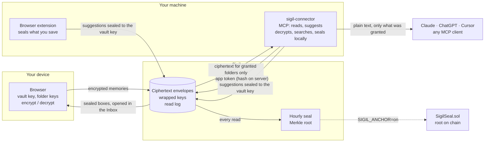
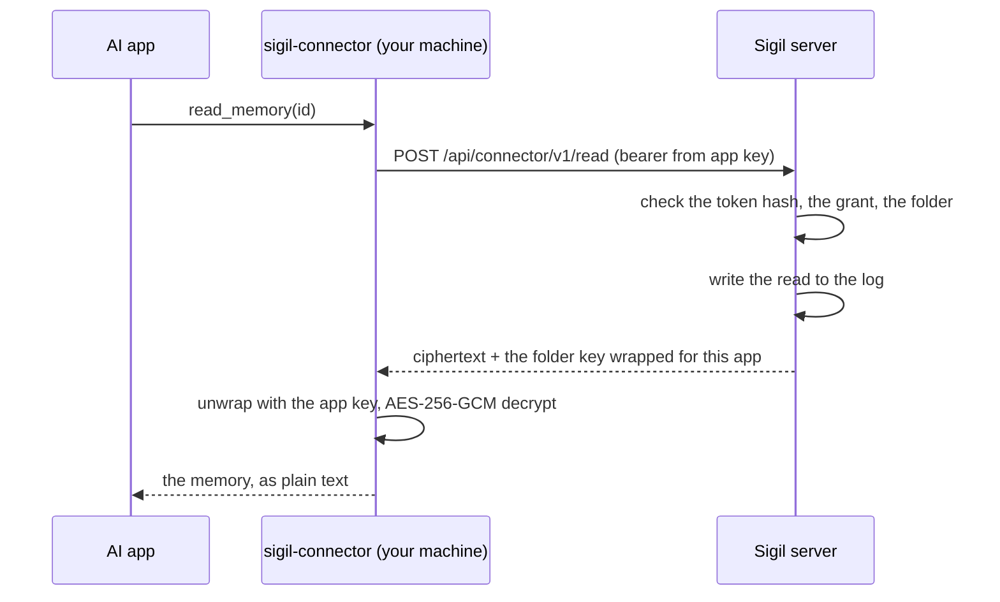

<div align="center">


<br/>

[](LICENSE)
[](#the-encryption-model)
[](#the-connector)
[](#tests)
[](#repository)

**One memory for every AI you use. Encrypted on your device. Read only where you allow it. Every read on the record.**

[How it works](#how-it-works) · [Encryption](#the-encryption-model) · [Connector](#the-connector) · [Inbox](#the-memory-inbox) · [Meaning](#search-by-meaning) · [Extension](#the-browser-extension) · [Sign in with Sigil](#sign-in-with-sigil) · [Sharing](#sharing-a-folder) · [Threat model](#threat-model) · [Run it](#run-it) · [Roadmap](#roadmap)

</div>

---

## Why Sigil

Every AI app keeps its own memory of you, locked inside that app, readable by the company that runs it. Sigil turns that around.

- **One vault, every app.** Claude, ChatGPT, Cursor and any MCP client read the same memory through one connector.
- **Encrypted before it leaves your device.** The server stores envelopes it cannot open. Search runs on your machine.
- **Per app, per folder.** Claude may read *Work* and *Writing*, Cursor only *Work*, and nothing reads *Health* unless you say so. Revoke takes effect on the very next request.
- **Every read on the record.** Each read by each app is logged, and every finished hour of the log is sealed into one fingerprint you can verify in your browser.
- **Apps suggest, you decide.** An app you allow can suggest a memory. It is sealed for your vault on the app's side and waits in your inbox until you approve, merge or reject it.
- **Search by meaning, on your device.** A small model runs in your browser and in the connector. Ask about your car and find the note about the garage; the server never sees the query or the vectors.
- **A Self card.** A short profile your apps read first, in its own folder, granted like any other.
- **Save from the browser.** The extension saves a selection, a page or a ChatGPT or Claude conversation to your inbox.
- **Sign in with Sigil.** Web apps ask for the folders they need; you choose, and you can revoke.
- **Share with people.** Share a folder with another vault, read only, and take it back with a new key.
- **Bring your history.** Import a ChatGPT or Claude data export in one step. It is parsed and encrypted in the browser.
- **Real delete.** Delete a memory, a folder or the whole account, and it is gone. Export everything, decrypted on your device, at any time.

---

## How it works



1. **Create a vault** with a passkey or a wallet. The browser makes a random 256-bit vault key and a 24-word recovery phrase.
2. **Write or import** memories. Each is encrypted with its folder's key before it is sent.
3. **Connect an app.** The vault makes an app key for it, shown once, that can unwrap only the folders you picked.
4. **The app reads** through `sigil-connector` on your machine, which fetches ciphertext and decrypts it locally.
5. **The app suggests**, if you allow it: the suggestion is sealed to your vault's public key and waits in your inbox.
6. **Every read and suggestion is logged**, and at the end of each hour the log is sealed into a Merkle root.

<details>
<summary><b>A single read, step by step</b></summary>



</details>

---

## The encryption model

| Key | Made where | Wrapped by | Used for |
| --- | --- | --- | --- |
| **Vault key** (256-bit) | Your browser, at sign-up | Each sign-in method separately: passkey PRF output, a wallet signature over a fixed message, the 24-word recovery phrase | Wrapping the folder keys |
| **Folder key** | Your browser | The vault key | Encrypting every memory in that folder |
| **App key** `sigil_app.<id>.<secret>` | Your browser, shown once | Never stored | Deriving the app's bearer token, the key that unwraps only its granted folder keys, and the key that checks the vault public key |
| **Vault box key** (X25519) | Your browser, at sign-up | The vault key (private half); the public half is in the clear | Opening suggestions and folders shared with you, which others seal to the public half |

Every ciphertext is AES-256-GCM, bound to its own record with associated data, so an envelope cannot be swapped into another record. Keys are derived with HKDF.

Data for a vault that is not open is a **sealed box**: a fresh X25519 key pair per message, HKDF-SHA256 over the shared secret (salted with both public keys, labelled with the record it belongs to), and XChaCha20-Poly1305 with that label as associated data. Format `s1.<ephemeral key>.<nonce>.<ciphertext>`. All primitives come from the audited `@noble` libraries.

**What the server sees, and what it does not**

| The server stores | The server never sees |
| --- | --- |
| Ciphertext envelopes, ids, sizes, times | Your memories, titles, tags or folder names in readable form |
| Hashes of sign-in and app tokens | Your vault key, folder keys, app keys or recovery phrase |
| Wallet addresses used to sign in | What an AI app searched for (search runs in the connector) |
| Which app read which memory id, and when (the read log) | Anything an app was not granted |
| The vault public key; that a suggestion arrived and from which app | What a suggestion says (a sealed box only your vault opens) |
| That a folder is shared with another vault | The folder key (sealed to that vault), who you call them |
| The files of the search model (the same for everyone) | Your search queries and the vectors made from your memories |

---

## The connector

`sigil-connector` is a small MCP server you run on your own machine. It offers four tools that read and one that suggests:

| Tool | What it does | What lands in your read log |
| --- | --- | --- |
| `get_profile` | Your Self card, when the app may read its folder. Apps are told to call it first | The app read the index, then the card |
| `list_folders` | The folders this app may read, with how many memories each holds | The app listed its folders |
| `search_memories` | Searches by meaning and by the words in titles, tags and first lines, decrypted and searched locally | The app read the index of its folders |
| `read_memory` | Returns one memory in full | The app read that memory |
| `propose_memory` | Suggests a memory to your inbox, sealed on your machine for your vault. Only for apps you allowed | The app suggested a memory |

There is no tool to change or delete a memory: a suggestion becomes a memory only when you approve it.

<details>
<summary><b>Claude Desktop</b></summary>

`~/Library/Application Support/Claude/claude_desktop_config.json` on macOS, `%APPDATA%\Claude\claude_desktop_config.json` on Windows:

```json
{
  "mcpServers": {
    "sigil": {
      "command": "node",
      "args": ["/path/to/Sigil/connector/dist/index.js"],
      "env": {
        "SIGIL_APP_KEY": "sigil_app.<app id>.<secret>",
        "SIGIL_URL": "http://localhost:3000"
      }
    }
  }
}
```

</details>

<details>
<summary><b>Cursor and other stdio MCP clients</b></summary>

The same command and environment, in the client's MCP settings:

```sh
SIGIL_APP_KEY=sigil_app.<app id>.<secret> \
SIGIL_URL=http://localhost:3000 \
node /path/to/Sigil/connector/dist/index.js
```

</details>

<details>
<summary><b>ChatGPT and clients that need a URL</b></summary>

```sh
node /path/to/Sigil/connector/dist/index.js --http --port 8787
# serves http://127.0.0.1:8787/mcp/<token>
```

ChatGPT reaches it through a tunnel you run yourself; what it may connect depends on your ChatGPT plan.

</details>

---

## The memory inbox

Each app has a switch, **May suggest memories to your inbox**, off until you turn it on under Apps.

1. Your vault has an X25519 key pair; the private half is wrapped by your vault key. Turning suggestions on makes your browser tag the public key with a key derived from that app's own secret.
2. The connector (or the extension, or a web app) fetches the public key and its tag, checks the tag, and only then seals the suggestion. A server that swapped in a key of its own fails that check.
3. The **Inbox** tab opens each suggestion with your key. Edit it, approve it into a folder, merge it into an existing memory, or reject it. The vault points out suggestions that are already there.

Suggestions are written to the read log. One app may send 30 an hour, and an inbox holds up to 500.

## Search by meaning

A small sentence model (all-MiniLM-L6-v2, about 23 MB, on WebAssembly) runs in a worker in the vault and inside the connector. Memories and queries become vectors on the device; results that match by meaning are ranked with results that match by words.

- Queries and vectors never reach the server. It only serves the model files, fetched once from the public model hub into its data folder (`SIGIL_MODEL_FETCH=off` keeps it offline).
- The vault keeps vectors in the browser's storage, AES-256-GCM under a key derived from the vault key, filed under HMAC names. The connector keeps them in memory.
- **Duplicates** (the same text, nearly the same words, or the same meaning) are found and merged in one step. The **Timeline** shows every memory by date and source.
- The **Self card** is a short profile (who you are, how you like answers, current projects) in its own folder, read by apps through `get_profile`.

## The browser extension

`extension/` is a Chrome extension (Manifest V3). It saves the selected text, the current page, or a whole ChatGPT or Claude conversation to your inbox, sealed in the browser.

```sh
npm run build -w sigil-extension   # then chrome://extensions, Developer mode, Load unpacked, extension/dist
```

Pair it in its options with your Sigil address and an app key from Apps (a *Browser extension* with suggestions on; it needs no folders). It reads only chatgpt.com and claude.ai on its own, and other pages only when you ask it to save them.

## Sign in with Sigil

`packages/sdk` lets a web app ask for read access to folders you choose:

```js
import { requestAccess, SigilClient } from "@sigil/sdk";

const access = await requestAccess({ vault: "https://your-sigil.example", appName: "My app" });
const sigil = new SigilClient(access);
await sigil.search("trip to Rome");   // decrypted and searched in the browser
```

A window from your vault opens at `/vault/authorize`; you unlock, choose folders, and allow. The vault makes an app key for that app and posts it only to the page's own origin. The app appears under Apps, where you can change or revoke it, and its reads are in your log. A complete example is in `examples/hello-sigil`.

## Sharing a folder

Share a folder with another Sigil vault, read only. The other person gives you their **vault code** (their public key and a check, with a fingerprint to compare). Your browser seals the folder key to that key; they accept it, and the folder shows in their vault. Each time their vault opens it, a line goes into your read log.

**Stop sharing** rotates the folder key on your device: every memory in the folder is encrypted again, and the new key is wrapped for you, for each app that may read the folder and for everyone you still share it with, in one transaction. The removed vault keeps only the old key, which opens nothing stored now.

---

## Hourly seals

Every request a connected app makes is written to your read log with a random salt. When an hour ends, all of that hour's entries become leaves of one Merkle tree, and its root is the seal for that hour.

- **Verify any entry in your browser.** The vault's read log has a Verify button on each entry: it rebuilds the path from the entry to the hour's root.
- **On chain, when switched on.** `contracts/src/SigilSeal.sol` records hourly roots so nobody, Sigil included, could change them later. It is written and tested (15 Foundry tests, including fuzzing and a shared test vector that proves the browser and the contract compute seals the same way) and is not deployed yet. While `SIGIL_ANCHOR` is off, every seal is labelled *Local*.

---

## Threat model

| If this happens | What it means for you |
| --- | --- |
| The Sigil server is breached | The attacker gets ciphertext, wrapped keys and token hashes. Without your keys none of it opens. |
| An app is given *Work* only | It never receives the keys for other folders, so it could not read them even if it tried. |
| An app suggests something false | It waits in your inbox until you approve it. Suggestions are off for every app unless you turn them on. |
| The server hands an app a public key of its own | The app checks it against a tag your vault made with the app's secret, and seals nothing. |
| You stop sharing a folder | It gets a new key; the person you removed holds only the old one, which opens nothing stored now. |
| You revoke an app | Its token hash and wrapped keys are deleted; its next request fails. What it already read, it keeps. |
| You lose your passkey | Sign in with a wallet or your recovery phrase. Keep at least two ways in. |
| You lose every way in | The vault cannot be recovered, by you or by Sigil. That is the price of keys only you hold. |
| An AI app or a person misuses text they were allowed to read | Sigil cannot control that. Share folders only with apps and people you trust. |

---

## Repository

```
Sigil
├── packages/core   client-side cryptography, key slots, app keys, sealed boxes,
│                   sharing and key rotation, Merkle seals, search by words and
│                   meaning, the on-device model runtime, export parsers
├── packages/sdk    Sign in with Sigil for web apps
├── web             the site and the server: Next.js App Router, the vault
│                   dashboard, the API in web/src/server, SQLite storage
├── connector       sigil-connector, the MCP server you run on your machine
├── extension       the Chrome extension (Manifest V3)
├── examples        hello-sigil, a small web app that signs in with Sigil
├── contracts       SigilSeal.sol for on-chain seal roots (Foundry)
├── e2e             Playwright: the whole product, end to end, in Chrome
└── docs            design brief, screenshots, README assets
```

<details>
<summary><b>API</b></summary>

| Route | What it does |
| --- | --- |
| `GET /api/status` | Health of the service and the seal job |
| `GET /api/seals` | The hourly seals |
| `GET /api/semantic` | Whether search by meaning is on, and the model the vault loads |
| `GET /models/<model>/<file>` | The model's files, from the server's data folder |
| `GET /api/connector/v1/folders` | The folders an app may read (app token) |
| `GET /api/connector/v1/index` | Encrypted titles, tags and first lines of its folders (app token) |
| `POST /api/connector/v1/read` | One memory's ciphertext, logged before it is answered (app token) |
| `GET /api/connector/v1/inbox` | The vault public key and the tag for this app, if it may suggest (app token) |
| `POST /api/connector/v1/proposals` | One sealed suggestion into the inbox, logged (app token) |

The connector routes answer any origin, since they take a bearer token and never a cookie. The vault's own routes (sign-up, sign-in, memories, folders and their key rotation, apps, the inbox, shares, export, delete) are under `web/src/server/api.ts`.

</details>

---

## Run it

Needs Node.js 22.13 or newer (for the built-in SQLite) and, for the contract tests, [Foundry](https://getfoundry.sh).

```sh
npm install
npm run build        # the connector and the site
npm start            # http://localhost:3000, data in web/.data/sigil.db
```

For development: `npm run dev`. Settings are in `web/.env.example`:

| Setting | Default | What it does |
| --- | --- | --- |
| `SIGIL_SEALS` | `on` | Seal the read log at the end of every hour |
| `SIGIL_ANCHOR` | `off` | Publish seal roots to SigilSeal (needs `SIGIL_ANCHOR_RPC_URL`, `SIGIL_SEAL_CONTRACT`, `SIGIL_SEALER_KEY`) |
| `SIGIL_SEMANTIC` | `on` | Search by meaning in the vault (the model runs in the browser) |
| `SIGIL_EMBED_MODEL` | `Xenova/all-MiniLM-L6-v2` | The sentence model |
| `SIGIL_MODEL_DIR` | `web/.data/models` | Where its files are kept |
| `SIGIL_MODEL_FETCH` | `on` | Fetch missing model files once from the public model hub |
| `NEXT_PUBLIC_SITE_URL` | | The public address, used in connector snippets |
| `SIGIL_ORIGIN` | | The origin trusted for passkeys in production |

## Tests

```sh
npm run test:unit       # 176: cryptography, sealed boxes, sharing, search by meaning, imports,
                        #      seals, server, connector, extension, SDK
npm run test:contracts  # 15: SigilSeal, with fuzzing and a cross-check against the browser
npm run test:e2e        # 17: sign up, import, connect, read, revoke, the inbox, the Self card,
                        #     search by meaning, sharing, Sign in with Sigil, the site
```

The server tests check that no plaintext ever reaches the database or leaves the browser. Search by meaning is tested with a tiny generated model kept in `packages/core/test/fixtures/tiny-model`, so no test needs the network.

---

## Roadmap

| | Stage | Status |
| --- | --- | --- |
| 1 | **The vault**: passkey and wallet sign-in, client-side encryption, folders, ChatGPT and Claude import, export, real delete | Built |
| 2 | **Every AI, one memory**: the MCP connector, per-app folder grants, revoke, the read log, hourly seals, the memory inbox, the browser extension, Sign in with Sigil, sharing between vaults | Built |
| 3 | **Your whole digital life**: mail, calendar, code and documents into the vault | Planned |
| 4 | **Memory that thinks**: search by meaning on the device, duplicates, a timeline and the Self card are built; stale facts, timelines of people and projects, briefs and a fully local mode are next | Started |
| 5 | **Your AI self**: a model of you that answers within your rules | Planned |
| 6 | **Agents get memory**: vaults for AI agents and shared spaces | Planned |
| 7 | **The memory economy**: what you know, licensed on your terms | Planned |
| 8 | **Trust**: an open standard for apps that read personal memory | Planned |
| 9 | **Everywhere**: phone app, recovery and legacy | Planned |
| 10 | **Devices**: wearables, car and home | Planned |
| 11 | **Your AI self in the world** | Planned |
| 12 | **Proof of a real life** | Planned |
| 13 | **Collective memory** | Planned |

Plans can change. Nothing in the roadmap is a promise or an offer.

---

<div align="center">

**MIT** · Early software, not yet audited: use it at your own risk and keep your own export.

</div>
